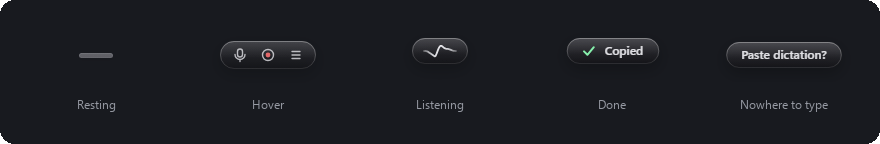

<p align="center"></p>

<p align="center">
  <a href="https://github.com/Loathious/Syllune/releases"></a>
  
  
</p>

<h3 align="center">Talk instead of typing. Everything stays on your PC.</h3>

Hold a shortcut, speak, release. Syllune types what you said wherever your cursor is: a chat box, an editor, a search field. Speech recognition runs on your own computer with [faster-whisper](https://github.com/SYSTRAN/faster-whisper), so nothing is uploaded, there is no account, and once the speech model is downloaded it works offline.

<p align="center"></p>

## What it does

- **Dictation anywhere.** Hold Ctrl+Win and talk. Double-tap to go hands-free. Pause to think mid-sentence; it keeps listening while the keys are held.
- **Your words, not a rewrite.** Your phrasing is kept; the optional AI edit only fixes punctuation and obvious slips. In AI chat apps it offers a structured-prompt version after you dictate, which you can take or ignore.
- **Never lost.** Every dictation is also on the clipboard. If there was nowhere to type, the pill asks "Paste dictation?" the next time you click into a text field.
- **A pill that stays out of the way.** It rests as a thin line at the edge of the screen, opens when your cursor comes near, and docks at the bottom or either side.
- **Learns your vocabulary.** Names and terms you say often join the dictionary by themselves. Add a word once and it is spelled your way from then on.
- **Meetings, notes and history.** Record a meeting, save a voice note, and search, fix or replay anything you have dictated.
- **Fast.** Uses your NVIDIA GPU if you have one and falls back to the CPU if you don't. English and Swedish.

## Install

Get the installer from the [Releases page](https://github.com/Loathious/Syllune/releases). It installs for your user only and needs no admin rights or developer tools. The installer is unsigned, so Windows SmartScreen asks before running it.

Optional: install [Ollama](https://ollama.com) and Syllune uses a local model to tidy longer dictations. Without it, dictation works the same.

[Install and update](docs/syllune-install.md) · [Troubleshooting](docs/syllune-troubleshooting.md) · [Privacy](docs/syllune-privacy.md) · [Changelog](CHANGELOG.md)

## Privacy

Audio, transcripts, settings and statistics stay in `%APPDATA%\Syllune`. The only network requests are model downloads and the optional check for a new release.

## Development

```powershell
py -3.12 -m venv .venv
.venv\Scripts\python.exe -m pip install -e .
cd overlay; npm ci; cd ..
.venv\Scripts\python.exe start-syllune.py
```

## License

Proprietary, by Loathious. The source is public so you can see what it does, but it may not be copied or redistributed. See [LICENSE](LICENSE) and [THIRD_PARTY_NOTICES.md](THIRD_PARTY_NOTICES.md).
